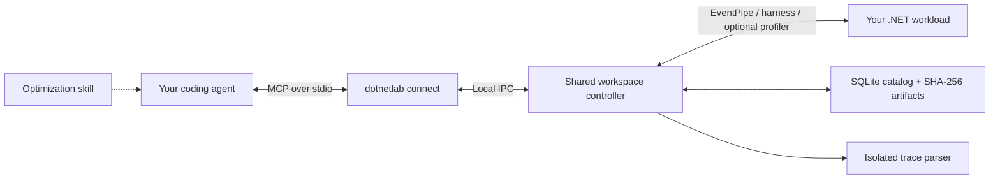

# Tedd.DotNetLab

**A .NET performance laboratory that helps your AI coding agent make your application faster.**

Give your agent a performance goal. DotNetLab equips it to **find bottlenecks, implement optimizations, and verify the gains** with runtime profiling, C# optimization guidance, and the scientific method.

For **Codex, Claude Code, Cursor, and Google Antigravity**. Windows and Linux x64 · .NET 6+ CoreCLR applications · Apache-2.0.

[Get started](#installation) · [Measured result](#measured-result) · [Scientific method](#scientific-method) · [Technical capabilities](#technical-capabilities) · [Example prompts](#example-prompts-to-give-your-ai) · [Website](https://tedd.no/Tedd.DotNetLab/)

After installation, open your application's repository and ask your agent:

```text
Use DotNetLab to improve this application's performance.
Find the largest bottlenecks, implement candidate optimizations,
and retain changes supported by measurements and correctness checks.
```

Your coding agent writes the C# changes. DotNetLab supplies the **Model Context Protocol (MCP) server**, CLI, and companion **`dotnetlab` skill** that guide profiling, experimentation, and interpretation. Bring an application, service, library, or batch job and a representative workload.

Initial profiling attaches to an accessible running process without application code changes. For controlled comparisons and fresh-build confirmation, your agent integrates the [cooperative harness](docs/harness-integration.md) with repeatable inputs and correctness checks.

## Measured result

**66.4% less time per matching call** in the dense-16384 scenario of Tedd.WildcardMatch. The change tracks how far a newline check has scanned, so rejected literal anchors no longer cause the same prefix to be scanned repeatedly.

| Matching workload | Original ns/call | Optimized ns/call | Result |
| --- | ---: | ---: | --- |
| Dense, 4,096-character prefix | 654,963.0 | 475,514.9 | 27.4% less time |
| Dense, 16,384-character prefix | 8,259,676.3 | 2,771,530.9 | 66.4% less time |
| Ordinary | 84.9 | 84.7 | Equivalent within ±5% |
| Newline | 155,255.8 | 127,016.4 | 18.2% less time |

Measured on Windows x64, CoreCLR 10.0.12, and an AMD Ryzen 9 5950X on 15 October 2026. Each scenario used ten randomized paired blocks with fresh baseline and candidate processes. Values are geometric means of batch means; correctness checks passed in all 80 confirmation sessions.

The study covers one pattern and four synthetic input distributions. Host load, CPU affinity, frequency, and thermal state were uncontrolled; these results describe the matching calls. The [measurement data](site/evidence/wildcard-validation.json) records the protocol, uncertainty intervals, and scope. Inspect the [measured source change](site/evidence/wildcard-candidate.patch) or the [reproduction driver](tests/wildcard-validation/README.md).

## Scientific method

The companion skill turns a performance goal into a repeatable investigation:

1. **Observe.** Establish a baseline and profile a representative workload. Locate CPU costs, allocations, GC pauses, and contention before choosing a change.
2. **Hypothesize.** Explain the measured cost and predict how a focused change would reduce it. Define the primary metric, useful improvement threshold, correctness checks, and regression guardrails before collecting candidate measurements.
3. **Experiment.** Implement the candidate, validate its outputs, and inspect generated machine code where relevant. Compare it with the baseline using a frozen randomized plan, warmup, and an explicit sample budget.
4. **Verify and iterate.** Confirm promising source changes in fresh, diagnostics-disabled processes. Retain changes supported by the performance and correctness checks, revert unsupported candidates, and profile again as bottlenecks shift.

DotNetLab retains hypotheses, plans, measurements, and decisions across sessions. Confidence intervals, equivalence tests, and declared guardrails help your agent distinguish useful improvements from noise and regressions. See the [statistical contract](docs/statistical-contract.md) for the inference rules and assumptions.

## Technical capabilities

### Runtime diagnostics and code inspection

| Capability | What it enables |
| --- | --- |
| **Live CPU profiling** | EventPipe sample capture, inclusive/exclusive call-stack hotspots, and target execution-window analysis to locate expensive methods. |
| **Allocations, GC, and runtime events** | Allocation stacks, per-generation GC pauses, runtime counters, contention and JIT events, and correlation of GC suspensions with measured execution windows. |
| **JIT x64 assembly** | Live native-code snapshots, IL/metadata inspection, `Iced` disassembly, and instruction diffs to investigate inlining, bounds checks, and vectorization. |
| **Live C# method replacement** | Import a selected compiled method body and test it through CoreCLR ReJIT while retaining the process and application objects. Supported bodies include instance fields, floating-point arithmetic, arrays, spans, refs, structs, and existing SIMD calls. |
| **Selected method probes** | Instrument supported methods for invocation counts, normal/exceptional outcomes, and optional timing, with setup validation and original-body restoration. |
| **Runtime comparisons** | Discover installed .NET runtimes and pin an exact release or preview using `target_runtime_version`. Windows `Core_Root`/`corerun` development builds have a separate quiet-validation workflow. |

Live native inspection, ReJIT, and probes use the optional C++ CoreCLR `ICorProfilerInfo12` adapter. Windows x64 supports live profiler attachment and startup instrumentation; Linux x64 supports startup instrumentation. ReJIT uses explicitly disposable targets and supported, already-compiled nongeneric methods whose signatures, type layouts, and referenced metadata match the loaded module. Cooperative application-thread boundaries coordinate installation and correctness checks. See [native qualification](docs/native-qualification.md) for method, caller, and runtime requirements.

### Controlled experiments and confirmation

| Capability | What it enables |
| --- | --- |
| **Synchronous and asynchronous harnesses** | Repeatable scenarios with preparation, reset, validation, and cleanup outside measured work; batch timing, completed-operation counts, and scoped allocation measurements. |
| **A/B and multi-variant comparisons** | Preregistered, seeded randomized complete block designs with fixed inputs, warmup, budgets, primary metrics, and acceptance policies. |
| **Statistical inference** | Paired log-ratio t-intervals for positive costs, absolute-difference analysis for allocations, family-wise error control, and two one-sided tests (TOST) for equivalence. |
| **Multiple objectives** | Evaluate elapsed cost, throughput, allocation, and qualified GC-overlap objectives together. Primary metrics and mandatory guardrails govern acceptance; Pareto comparisons expose tradeoffs. |
| **Factorial experiments** | A 2 × 2 design measures each optimization, their combination, conditional effects, and interaction—for example, whether span parsing and buffer pooling reinforce each other. |
| **Tail latency** | Retain individual-operation observations and compare p50, p95, p99, or p99.9 using paired cluster-bootstrap inference under a declared independence model. |
| **Fresh-build confirmation** | Build baseline and candidate bundles, then compare them in separate, diagnostics-disabled OS processes per randomized block arm. Verify build/runtime identity, correctness, and guardrails before recording an adoption decision. |

The [harness guide](docs/harness-integration.md) covers `ISynchronousScenario`, `IAsynchronousScenario`, application-thread dispatch, and owned-process execution. Live ReJIT results are exploratory; source adoption requires fresh normal-build confirmation.

### Optimization guidance

The [agent skill](skills/dotnetlab/SKILL.md) routes each measured bottleneck to a focused C#/.NET playbook:

| Area | Candidate strategies |
| --- | --- |
| [Algorithms and lookups](skills/dotnetlab/references/playbooks/algorithms-and-lookups.md) | Remove repeated work, reduce algorithmic complexity, fuse passes, improve lookup structures, and use `SearchValues` or frozen collections where appropriate. |
| [Memory and data layout](skills/dotnetlab/references/playbooks/memory-and-layout.md) | Spans, buffer pooling, UTF-8 pipelines, compact representations, cache locality, and array-of-structs versus struct-of-arrays layouts. |
| [JIT, CPU pipelines, and branches](skills/dotnetlab/references/playbooks/jit-cpu-and-bounds.md) | Inlining, bounds-check elimination, specialization, dependency chains, branch predictability, and dynamic PGO. |
| [SIMD and hardware intrinsics](skills/dotnetlab/references/playbooks/simd-and-intrinsics.md) | Vectorized library APIs, `Vector128`/`256`/`512`, instruction-set guards, vector tails, and width tradeoffs. |
| [Concurrency and runtime behavior](skills/dotnetlab/references/playbooks/concurrency-and-runtime.md) | Lock contention, false sharing, batching, bounded parallelism, async allocation costs, and source-generated serializers and regexes. |

The agent selects candidates from measured evidence, checks their semantics and generated code, and tests whether they improve the declared workload.

### MCP interface and retained evidence

The server exposes six base tools and one optional native tool:

| Tool | Purpose |
| --- | --- |
| `lab.discover` | Find processes, runtimes, scenarios, profiles, and available capabilities. |
| `lab.inspect` | Inspect experiment records, stored assemblies, IL, metadata, and live native code. |
| `lab.experiment` | Register hypotheses, candidates, baselines, and immutable experiment plans. |
| `lab.run` | Capture traces, execute experiments, analyze evidence, and run fresh-build confirmation. |
| `lab.query` | Retrieve evidence, measurement windows, notebook records, and bounded artifact slices. |
| `lab.compare` | Evaluate statistical comparisons, objectives, factorial effects, and confirmation gates. |
| `lab.patch` | Preflight and apply supported CIL replacements or probes, then restore the original; enabled with `--enable-native-extension`. |

A local SQLite catalog links hypotheses, baselines, immutable plans, and decisions to SHA-256 content-addressed artifacts. CLI evidence administration supports pinning, export, import, and catalog backup; retained results remain available after agent or controller restarts. Scoped CLI grants bind observation, execution, builds, native changes, and evidence administration to specific targets or plans, expiry times, and operation budgets.

See the [CLI and MCP reference](docs/cli-and-mcp-reference.md), [JSON schemas](schemas/api/v1/), and [evidence guide](docs/evidence-management.md).

## Prerequisites

| Component | Requirement |
| --- | --- |
| **Platform** | Windows x64 or Linux x64, including WSL2. |
| **DotNetLab controller and CLI** | .NET 10.0+ runtime or SDK. Major-version and prerelease roll-forward are enabled by the installer. |
| **Target applications** | CoreCLR .NET 6.0+. Use `dotnetlab compatibility` and target capability discovery to check the available workflows. |
| **Coding client** | [Codex](https://github.com/openai/codex), [Claude Code](https://docs.anthropic.com/en/docs/claude-code), [Cursor](https://cursor.com), or [Google Antigravity](https://antigravity.google). |

Linux trace parsing requires a delegated cgroup v2 subtree with `memory` and `pids` controllers. Linux/WSL catalogs must reside on a local Linux filesystem. See the [setup guide](docs/building-and-verification.md) and [runtime compatibility matrix](docs/architecture-and-runtime.md#runtime-compatibility-matrix).

---

## Installation

You can install `Tedd.DotNetLab` for **Codex**, **Claude Code**, **Cursor**, **Google Antigravity**, or **all four at once**—via a one-line shell command, an AI self-install prompt, building from source, or manual configuration.

### Option 1: One-Line Shell Installer (Recommended)

Downloads the latest GitHub Release (verifying SHA-256 checksums, or automatically building from source if no prebuilt release matches), places the `dotnetlab` CLI on your user `PATH`, copies the `dotnetlab` skill, and registers the MCP server across **Codex, Claude Code, Cursor, and Antigravity** without touching your other settings.

**Windows (PowerShell):**

```powershell
irm https://raw.githubusercontent.com/tedd/Tedd.DotNetLab/main/tools/install.ps1 | iex
```

**Linux / WSL2 (Bash):**

```bash
curl -fsSL https://raw.githubusercontent.com/tedd/Tedd.DotNetLab/main/tools/install.sh | bash
```

**Start your first investigation:**

1. Restart your coding client so the MCP tools and companion skill load.
2. Run `dotnetlab compatibility` in your terminal to verify the installation.
3. Open your application's repository and give your agent the starting prompt above, along with a representative workload or instructions to reproduce it.

The agent can begin by profiling an accessible running process. It integrates a cooperative scenario when the investigation needs controlled comparisons or fresh-build confirmation.

<details>
<summary><strong>Installer options (install from source, select specific AI clients, or enable native ReJIT tool)</strong></summary>

**Install directly from a local git clone (from source):**
```powershell
# Windows PowerShell
git clone https://github.com/tedd/Tedd.DotNetLab.git
cd Tedd.DotNetLab
pwsh -NoProfile -File ./tools/install.ps1 -FromSource
```
```bash
# Linux / WSL2 Bash
git clone https://github.com/tedd/Tedd.DotNetLab.git
cd Tedd.DotNetLab
./tools/install.sh --from-source
```

**Customize via environment variables on the one-liner (or script flags locally):**
```powershell
# Configure Cursor and Antigravity only:
$env:DOTNETLAB_CLIENT='cursor,antigravity'; irm https://raw.githubusercontent.com/tedd/Tedd.DotNetLab/main/tools/install.ps1 | iex

# Configure Codex only + enable the optional lab.patch native ReJIT tool:
$env:DOTNETLAB_CLIENT='codex'; $env:DOTNETLAB_ENABLE_NATIVE='1'; irm https://raw.githubusercontent.com/tedd/Tedd.DotNetLab/main/tools/install.ps1 | iex

# Configure Claude Code only, building from source:
$env:DOTNETLAB_CLIENT='claude'; $env:DOTNETLAB_FROM_SOURCE='1'; irm https://raw.githubusercontent.com/tedd/Tedd.DotNetLab/main/tools/install.ps1 | iex
```
</details>

---

### Option 2: Give an Install Prompt Directly to Your AI

Paste either prompt below into **Codex**, **Claude Code**, **Cursor**, or **Antigravity** and let the agent install `Tedd.DotNetLab` for you:

**Prompt A — Install from GitHub Release (with automatic source fallback):**
```text
Install Tedd.DotNetLab from https://github.com/tedd/Tedd.DotNetLab for my AI coding tools.
On Windows PowerShell run:
  irm https://raw.githubusercontent.com/tedd/Tedd.DotNetLab/main/tools/install.ps1 | iex
On Linux/WSL bash run:
  curl -fsSL https://raw.githubusercontent.com/tedd/Tedd.DotNetLab/main/tools/install.sh | bash
Then run `dotnetlab compatibility` to verify the installation and tell me to reload/restart my session so the `dotnetlab` MCP server and skill load.
```

**Prompt B — Build and install from source:**
```text
Clone https://github.com/tedd/Tedd.DotNetLab.git into a temporary directory, build and install it from source using `./tools/install.ps1 -FromSource` (Windows) or `./tools/install.sh --from-source` (Linux/WSL) so both the `dotnetlab` skill and MCP server are configured, verify with `dotnetlab compatibility`, and remove the temporary clone when finished.
```

---

### Option 3: Built-In `dotnetlab install` CLI

If you already built the repo (`dotnet build Tedd.DotNetLab.sln -c Release`) or extracted a release ZIP, `Tedd.DotNetLab.Host` includes a built-in idempotent installer that bundles `skills/dotnetlab`:

```bash
# Install for all supported clients: Codex, Claude Code, Cursor, & Antigravity (user scope):
dotnet /path/to/Tedd.DotNetLab.Host.dll install all

# Or install for one or more specific clients (comma-separated supported):
dotnet /path/to/Tedd.DotNetLab.Host.dll install codex
dotnet /path/to/Tedd.DotNetLab.Host.dll install claude
dotnet /path/to/Tedd.DotNetLab.Host.dll install cursor
dotnet /path/to/Tedd.DotNetLab.Host.dll install antigravity
dotnet /path/to/Tedd.DotNetLab.Host.dll install cursor,antigravity

# Install scoped to a specific project directory (.codex/, .claude/, .cursor/, .agents/, .mcp.json):
dotnet /path/to/Tedd.DotNetLab.Host.dll install all --scope project --project-dir /path/to/your-app

# Include the optional lab.patch native CIL/ReJIT MCP tool:
dotnet /path/to/Tedd.DotNetLab.Host.dll install all --enable-native-extension

# Uninstall cleanly (preserves all other MCP servers and settings):
dotnet /path/to/Tedd.DotNetLab.Host.dll uninstall all
```

**Or install via NuGet / `.NET Tool` packages (from NuGet or GitHub Release/Actions `.nupkg` artifacts):**
```bash
# Install the dotnetlab CLI + MCP host globally and register skills/MCP for your AI clients:
dotnet tool install -g Tedd.DotNetLab
dotnetlab install all

# Add the cooperative benchmark harness library to a target .NET project:
dotnet add package Tedd.DotNetLab.Harness
```

---

### Option 4: Manual Setup Instructions

<details>
<summary><strong>Manual setup for Codex</strong></summary>

1. **Copy the skill** into `$CODEX_HOME/skills/dotnetlab` (defaults to `~/.codex/skills/dotnetlab`, or `<your-project>/.agents/skills/dotnetlab` for project scope):
   ```bash
   mkdir -p ~/.codex/skills
   cp -R /path/to/Tedd.DotNetLab/skills/dotnetlab ~/.codex/skills/dotnetlab
   ```
2. **Initialize a workspace** for experiment catalogs and trace artifacts:
   ```bash
   dotnet /path/to/Tedd.DotNetLab.Host.dll init ~/.local/share/dotnetlab/workspace
   ```
3. **Register the MCP server** in `~/.codex/config.toml` (use escaped backslashes `\\` on Windows):
   ```toml
   [mcp_servers.dotnetlab]
   command = "dotnet"
   args = ["--roll-forward", "Major", "/absolute/path/to/Tedd.DotNetLab.Host.dll", "connect", "/absolute/path/to/workspace"]

   [mcp_servers.dotnetlab.env]
   DOTNET_ROLL_FORWARD_TO_PRERELEASE = "1"
   ```
   *(Optional: append `"--enable-native-extension"` to `args` to expose `lab.patch`.)*
4. Restart Codex. Invoke `$dotnetlab` explicitly or ask any .NET profiling/performance question.
</details>

<details>
<summary><strong>Manual setup for Claude Code</strong></summary>

1. **Copy the skill** into `~/.claude/skills/dotnetlab` (user-wide) or `<your-project>/.claude/skills/dotnetlab` (project-scoped):
   ```bash
   mkdir -p ~/.claude/skills
   cp -R /path/to/Tedd.DotNetLab/skills/dotnetlab ~/.claude/skills/dotnetlab
   ```
2. **Register the MCP server** via the `claude` CLI:
   ```bash
   claude mcp add --scope user -e DOTNET_ROLL_FORWARD_TO_PRERELEASE=1 dotnetlab -- dotnet --roll-forward Major /absolute/path/to/Tedd.DotNetLab.Host.dll connect /absolute/path/to/workspace
   ```
   Or merge into `~/.claude.json` (user scope) or `<your-project>/.mcp.json` (project scope):
   ```json
   {
     "mcpServers": {
       "dotnetlab": {
         "type": "stdio",
         "command": "dotnet",
         "args": [
           "--roll-forward",
           "Major",
           "/absolute/path/to/Tedd.DotNetLab.Host.dll",
           "connect",
           "/absolute/path/to/workspace"
         ],
         "env": {
           "DOTNET_ROLL_FORWARD_TO_PRERELEASE": "1"
         }
       }
     }
   }
   ```
3. Restart Claude Code. Invoke `/dotnetlab` or describe your .NET optimization goal directly.
</details>

<details>
<summary><strong>Manual setup for Cursor</strong></summary>

1. **Copy the skill** into `~/.cursor/skills/dotnetlab` (user-wide) or `<your-project>/.cursor/skills/dotnetlab` (project-scoped):
   ```bash
   mkdir -p ~/.cursor/skills
   cp -R /path/to/Tedd.DotNetLab/skills/dotnetlab ~/.cursor/skills/dotnetlab
   ```
2. **Register the MCP server** in `~/.cursor/mcp.json` (user-wide) or `<your-project>/.cursor/mcp.json` (project-scoped):
   ```json
   {
     "mcpServers": {
       "dotnetlab": {
         "type": "stdio",
         "command": "dotnet",
         "args": [
           "--roll-forward",
           "Major",
           "/absolute/path/to/Tedd.DotNetLab.Host.dll",
           "connect",
           "/absolute/path/to/workspace"
         ],
         "env": {
           "DOTNET_ROLL_FORWARD_TO_PRERELEASE": "1"
         }
       }
     }
   }
   ```
3. Reload Cursor (**Cursor Settings → Tools & MCP**) so `dotnetlab` tools and skill activate.
</details>

<details>
<summary><strong>Manual setup for Google Antigravity (`agy`)</strong></summary>

1. **Copy the skill** into `~/.gemini/config/skills/dotnetlab` (global user scope) or `<your-project>/.agents/skills/dotnetlab` (workspace scope):
   ```bash
   mkdir -p ~/.gemini/config/skills
   cp -R /path/to/Tedd.DotNetLab/skills/dotnetlab ~/.gemini/config/skills/dotnetlab
   ```
2. **Register the MCP server** in `~/.gemini/config/mcp_config.json` (global user scope) or `<your-project>/.agents/mcp_config.json` (workspace scope):
   ```json
   {
     "mcpServers": {
       "dotnetlab": {
         "type": "stdio",
         "command": "dotnet",
         "args": [
           "--roll-forward",
           "Major",
           "/absolute/path/to/Tedd.DotNetLab.Host.dll",
           "connect",
           "/absolute/path/to/workspace"
         ],
         "env": {
           "DOTNET_ROLL_FORWARD_TO_PRERELEASE": "1"
         }
       }
     }
   }
   ```
3. Start a new Antigravity session (or run `agy mcp list`) to verify `dotnetlab` is connected.
</details>

---

## Example Prompts to Give Your AI

Start with a performance goal, or specify the workload and experiment you want. These prompts show how to direct a more focused investigation after installation.

The skill issues bounded CLI grants within your authorized task. For per-grant review, tell your agent to request manual approval before issuing each grant.

### 1. Profile a Live .NET Application & Find Hotspots (Zero Code Changes)

Start your .NET service or app normally, then prompt your AI:

```text
Use DotNetLab to discover my running OrderService .NET process.
Capture CPU and allocation diagnostic traces for a representative
10-second workload. Show the top inclusive/exclusive CPU hotspots,
allocation hotspots, and whether GC pauses overlap request spikes.
```

### 2. Optimize a Hot Path with Rigorous A/B Benchmarking & Allocation Guardrails

```text
Use DotNetLab to optimize JsonPayloadParser.ParseBatch in this repo.
Profile a representative input corpus and form a hypothesis about
the largest cost before implementing a candidate.

Set up a cooperative harness scenario with output-equivalence checks.
Freeze a randomized block plan with at least 12 blocks, using
scenario.ns_per_operation as the primary metric and
allocation.thread_bytes as a non-regressing guardrail.

Report effect sizes and uncertainty. Retain the change only if it
passes the declared useful-improvement threshold, correctness checks,
and fresh-process normal-build confirmation.
```

### 3. Compare .NET Runtimes and JIT Code Generation

```text
Use DotNetLab to compare VectorizedHashKernel on my installed
.NET 10 and .NET 11 runtimes. Discover the exact versions and pin
each plan with target_runtime_version.

Compare throughput and allocations. Where native inspection is
available, inspect the x64 assembly for differences in bounds checks
and SIMD code generation. Report the workload and runtime identities
alongside the measured effects.
```

### 4. Investigate and Cut p99 Tail-Latency Spikes

```text
Use DotNetLab to investigate p99 latency in this message handler
under representative burst load. Capture per-operation latencies
and GC suspension timelines.

Test the current buffer strategy against an ArrayPool<byte> candidate.
Freeze the quantile plans before collection, check correctness, and
report paired cluster-bootstrap intervals with the session-independence
assumptions and observation counts.
```

### 5. Test Whether Two Optimizations Compound or Interfere ($2 \times 2$ Factorial)

```text
I have two candidate optimizations for `WildcardMatcher`:
- Factor A: SIMD `SearchValues<char>` literal prefiltering
- Factor B: stackalloc small state bitsets instead of heap arrays
Use DotNetLab to run a 2x2 factorial experiment (00, 10, 01, 11).
Use lab.compare with include_factorial: true to report each effect,
the combined result, and the interaction with uncertainty intervals.
```

### 6. Inspect JIT x64 Disassembly & Prototype via Native ReJIT

*(Requires `--enable-native-extension`; see [Native Qualification](docs/native-qualification.md)).*

```text
Use DotNetLab to inspect the live tiered JIT x64 assembly generated
for ChecksumKernel.Compute. Check for bounds checks or missed
vectorization in Tier-1 code.

If the method passes native preflight, test a compiled C# candidate
through ReJIT in a disposable target. Validate outputs, use the required
compilation control, and restore the original body between trials.
Confirm any selected source change in fresh normal builds.
```

### 7. Localize a Performance Regression

```text
Throughput on ImportPipeline regressed about 25%. Use DotNetLab to
investigate parser allocations, lock contention, and serializer costs.

Record competing hypotheses, collect evidence that distinguishes them,
and test the most strongly supported explanation. Preserve the baseline,
measurements, and final decision for the next investigation.
```

---

## How It Works at a Glance



- **Shared controller:** `dotnetlab connect` lets concurrent agent sessions share one workspace catalog and scheduler. Disconnecting a client leaves other sessions and accepted operations running.
- **Measurement coordination:** A machine-wide mutex serializes measurements, captures, and trace parsing across cooperating DotNetLab controllers. Unrelated host activity remains part of the measurement environment.
- **Bounded trace analysis:** EventPipe parsing runs in an isolated `TraceWorker`, constrained by Windows Job Objects or Linux cgroup v2 memory and process limits.
- **Separate exploration and confirmation:** Harness runs and native trials test candidates. Fresh normal-build confirmation verifies the selected source change with diagnostics disabled and retains the evidence for review.

See [architecture and runtime integration](docs/architecture-and-runtime.md) for transport, scheduling, storage, and process-lifecycle details.

---

## Documentation (`docs/`)

Detailed architectural, statistical, security, and operational documentation lives in [`docs/`](docs/):

| Document | Contents |
| --- | --- |
| [**Architecture & Runtime Integration**](docs/architecture-and-runtime.md) | Shared controller topology, named pipes, machine-wide measurement mutex, `TraceWorker` Job Object / cgroup v2 containment, oversized MCP chunking, and runtime compatibility matrix. |
| [**CLI & MCP Reference**](docs/cli-and-mcp-reference.md) | Complete reference for `dotnetlab` CLI commands, scoped security grants, all 6+1 MCP tools (`lab.discover`, `lab.inspect`, `lab.experiment`, `lab.run`, `lab.query`, `lab.compare`, `lab.patch`), and JSON Schemas. |
| [**Harness Integration Guide**](docs/harness-integration.md) | Embedding `Tedd.DotNetLab.Harness` (`ISynchronousScenario`, `IAsynchronousScenario`, `ApplicationThreadDispatcher`, `ListenAsync`, and `RunOwnedAsync`). |
| [**Statistical Contract**](docs/statistical-contract.md) | Paired log-ratio inference, family-wise error control, TOST equivalence, $2 \times 2$ factorial contrasts, cluster-bootstrapped quantiles, and simulation qualification. |
| [**Native Qualification & Confirmation**](docs/native-qualification.md) | CoreCLR `ICorProfilerInfo12` startup/attach scope, x64 disassembly snapshots, method probes, bounded CIL ReJIT safety/restoration, and fresh-process confirmation rules. |
| [**Evidence Management & Retention**](docs/evidence-management.md) | Privacy-filtered vs. raw bundle export, quarantined bundle import, artifact pinning, reference release, deletion grants, and SQLite backup/recovery. |
| [**Building, Packaging & Verification**](docs/building-and-verification.md) | Building managed & C++ components from source, reproducible Windows distribution packaging/verification, and running the requirement-evidence, dual-runtime, and WSL2 Linux suites. |
| [**Threat Model**](docs/threat-model.md) | Trust boundaries, capability grants, IPC peer verification, reparse-point defenses, and non-goals. |

---

## License

Licensed under the [Apache License, Version 2.0](LICENSE). See [SECURITY.md](SECURITY.md) for security boundaries and reporting guidance.
