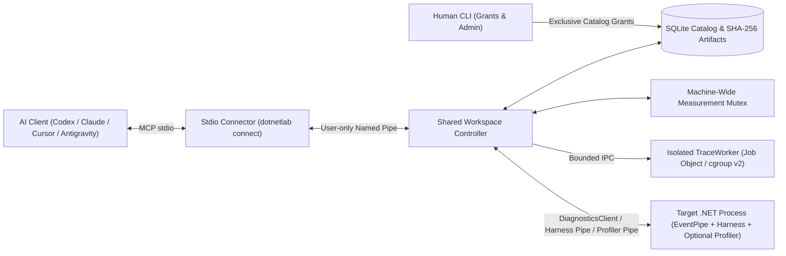

# Architecture and Runtime Integration

`Tedd.DotNetLab` is a local .NET performance-engineering, profiling, and scientific experimentation laboratory designed for AI coding agents (Codex, Claude Code, Cursor, Google Antigravity, and other MCP-compatible clients) and human performance engineers.

Instead of relying on ad-hoc console timers or unverified AI guesses, `Tedd.DotNetLab` provides a durable SQLite experiment catalog, content-addressed SHA-256 artifact storage, out-of-process EventPipe trace containment, cooperative benchmark harnesses, preregistered statistical inference, optional CoreCLR `ICorProfilerInfo12` native disassembly/ReJIT, and fresh-process confirmation.

---

## System Topology

---

## Shared Controller vs. Dedicated Server

- **`connect <workspace>` (Recommended for MCP clients):**
  Launches a lightweight stdio connector that forwards MCP traffic to a shared background controller for `<workspace>` over a local named pipe restricted to the current OS user.
  - Multiple concurrent MCP clients (for example, parallel subagents or IDE + terminal sessions) share one workspace catalog and job scheduler safely.
  - The background controller starts automatically on first connection and shuts down cleanly after **5 seconds** of inactivity once no clients, active jobs, or uncertain target measurements remain.
  - Disconnecting one MCP client leaves other connected clients and accepted background operations running.
- **`serve <workspace>`:**
  Runs a dedicated single-client stdio MCP server directly in the foreground process and requires exclusive catalog ownership for its lifetime.
- **Optional Native Extension (`--enable-native-extension`):**
  Appending `--enable-native-extension` to `connect` or `serve` registers the seventh MCP tool, `lab.patch`, for that client connection. Enabling the tool in MCP does **not** load a native profiler into any target, mint grants, or bypass runtime/epoch/preflight checks.

### Connection Diagnostics (`<workspace>/logs/`)

Connection lifecycle diagnostics are written as JSON Lines (`.jsonl`) files in `<workspace>/logs/`, named by process role, PID, and start time:
- Records startup, peer PIDs, session identities, stream EOF/errors, byte counts, controller heartbeats every 30 seconds, idle shutdown, and process exit.
- Exceptions record exception types, domain error codes, and bounded stack traces while excluding request/response payloads and raw exception messages.
- Each process rotates logs at **2 MiB** with one backup. On startup, inactive logs older than 7 days or beyond the newest 128 files are pruned. Logging failures report once to `stderr` and never interrupt MCP transport.

---

## Machine-Wide Measurement Exclusivity and Activity Scheduling

To prevent observer and parser cross-talk from corrupting latency or throughput measurements:

1. **Machine-Wide Named Mutex:**
   Cooperating `Tedd.DotNetLab` controllers acquire a machine-wide named mutex to serialize harness measurements, standalone EventPipe captures, and trace parsing across all workspaces on the host.
   - Queued operations can be cancelled without releasing the active owner's lock.
   - If a target fails to acknowledge quiescence (for example, a hung scenario or disconnected harness pipe), the controller retains the measurement lock until the exact `(PID, StartTimeUtcTicks)` session reports verified health or is confirmed terminated by the OS kernel.
   - *Boundary:* The mutex coordinates `Tedd.DotNetLab` controllers and workers; it cannot silence unrelated background applications or external profilers on the host.

2. **Controller-Wide Scheduler:**
   Within a controller, raw artifact verification, trace parsing, stack aggregation, and summary publication are excluded from overlapping controller-started harness measurements (batches, individual latencies, native controls/trials, and fresh normal-build confirmations). Queued parser work prevents later measurements from starving analysis, and queue wait time counts against the operation's wall-clock deadline.

---

## Oversized MCP Result Chunking

When an MCP tool response or notebook record exceeds the inline MCP payload budget:
- The complete JSON payload is sealed into a SHA-256-verified workspace artifact.
- The MCP response returns `representation="artifact"`, `truncated=true`, total byte length, SHA-256 hash, a resource URI, and a ready-to-call `lab.query` (`view="artifact_slice"`) pagination descriptor.
- Tool responses report `result_kind="lab_response"`; resource reads report `result_kind="notebook_record"`.
- Oversized result references automatically pin their backing artifact for **30 minutes**, after which standard workspace retention policy applies. Clients read sequential slices via `lab.query` and verify the assembled SHA-256 digest before interpreting the result.

---

## Isolated Trace-Parser Containment (`Tedd.DotNetLab.TraceWorker`)

EventPipe `.nettrace` parsing and sampled-stack aggregation execute out-of-process in `Tedd.DotNetLab.TraceWorker` under strict resource policies (bounding raw input bytes, event count, output bytes, managed heap, committed/charged memory, and wall-clock duration):

- **Windows x64:** Each worker runs inside a Windows Job Object that caps private committed memory and terminates child processes on cancellation, timeout, or controller exit.
- **Linux x64:** Requires an externally delegated **cgroup v2** subtree at `DOTNETLAB_PARSER_CGROUP_ROOT` with `memory` and `pids` controllers enabled:
  - The controller runs in its own leaf; each parser worker is placed in a fresh sibling cgroup leaf before `.NET` starts, with verified `memory.max`, swap disabled, group OOM kill enabled, and `pids.max` capped at 256 tasks/threads.
  - A Linux `pidfd` lifetime guard ensures the entire worker group is terminated even if the controller exits abruptly.
  - Linux memory accounting records kernel-charged anonymous, file, and kernel memory (`private_commit_collected=false`, charged peak, limit events, and OOM kills). Completed parses whose observed peak exceeds budget are rejected even if the kernel permitted transient overshoot.
- Failed or OOM-killed workers never publish partial summaries, while raw captured `.nettrace` artifacts remain intact in the store for bounded reanalysis (`lab.run` action `analyze_capture`).

---

## Workspace Catalog, Storage Filesystems, and Resource Policies

- **Catalog Schema v5:** Uses SQLite in WAL mode (`catalog.sqlite`) alongside a content-addressed `artifacts/` store. Every workspace has a stable identity and immutable, hash-verified `WorkspacePolicyRevision` records (defaulting to 8 active jobs and 64 queued parser/measurement activities). Every accepted operation binds its active policy revision in the same SQLite transaction.
- **Linux Filesystem Requirements:** On Linux/WSL, SQLite WAL shared-memory semantics require a local POSIX filesystem (**ext4**, **XFS**, **Btrfs**, or local **overlayfs**). `Tedd.DotNetLab` inspects filesystem magic before opening SQLite and rejects Windows-backed WSL `/mnt/*` (`drvfs`/`v9fs`), network shares, FUSE mounts, and `tmpfs`/volatile mounts for catalogs.
- **Disk Reserves:** Artifact writes and build staging check available volume free space (including nested mount points) with overflow-safe reserve arithmetic before allocating disk space.

---

## Runtime Compatibility Matrix

`Tedd.DotNetLab` separates **Controller compatibility** from **Target workload compatibility** so you can profile, benchmark, disassemble, and confirm applications running on any modern `.NET` release—including bleeding-edge previews like **`.NET 11 RC2`** or `.NET 12` previews—without artificial version locks:

| Component / Workflow | Windows x64 | Linux x64 | Notes |
| --- | --- | --- | --- |
| **Controller & CLI (`Tedd.DotNetLab.Host`)** | CoreCLR `.NET 10.0+` (including `.NET 11` / `.NET 12+` previews & RCs) | CoreCLR `.NET 10.0+` (including `.NET 11` / `.NET 12+` previews & RCs) | Built with `RollForward=Major`; installer sets `DOTNET_ROLL_FORWARD_TO_PRERELEASE=1` so preview-only machines work seamlessly. |
| **EventPipe Capture & Trace Analysis** | CoreCLR `.NET 6.0+` targets | CoreCLR `.NET 6.0+` targets | Requires human `observe` grant for the target `(PID, start_time)`. |
| **Managed Harness Execution & Normal-Build Confirmation** | CoreCLR `.NET 6.0+` (including `.NET 8`, `9`, `10`, `11.0-rc.*`, `12.0-*`) | CoreCLR `.NET 6.0+` (including `.NET 8`, `9`, `10`, `11.0-rc.*`, `12.0-*`) | Resolves exact or roll-forward target runtime across installed `dotnet` roots (`DOTNET_ROOT`, `PATH`, `~/.dotnet`, system `dotnet`). |
| **Raw `Core_Root` / `corerun.exe` Development Builds** | `12.0.0-dev` (quiet validation) | Separate qualification | Windows `quiet-validation` with leased `CoreLib`/`CoreCLR`/`clrjit` SHA-256 hashes at epoch `0`. |
| **Optional Exact Runtime Pin (`target_runtime_version`)** | Any exact SemVer `>= 6.0.0` (including preview/RC suffix) | Any exact SemVer `>= 6.0.0` (including preview/RC suffix) | Enforces `not_comparable` rejection if the target process differs from the frozen plan's runtime version. |
| **Native Inspection, Startup ReJIT & Probes (`ICorProfilerInfo12`)** | CoreCLR `.NET 6.0+` (including `.NET 10`, `.NET 11` RCs, `.NET 12+`) | CoreCLR `.NET 6.0+` (including `.NET 10`, `.NET 11` RCs, `.NET 12+`) | Uses public, ABI-stable `ICorProfilerInfo12` & `IMetaDataImport2` COM interfaces without private runtime struct offsets. |
| **Live Profiler Attach & No-Inline Attach ReJIT** | CoreCLR `.NET 6.0+` (including `.NET 10`, `.NET 11` RCs, `.NET 12+`) | Unsupported | Uses minimal event mask `0x40024` and verified one-shot attachment plan. |

### Inspecting Compatibility

Run `dotnetlab compatibility` (or MCP `lab.discover` with `{"action":"compatibility"}`) at any time to inspect:
- Build-pinned SDK, CoreCLR, and NuGet package versions.
- Active controller runtime version, architecture, and CoreCLR engine check.
- Loaded dependency MVIDs and SHA-256 binary hashes.
- Configured native profiler binary availability and platform feature matrix.

---

## Controller Self-Observation and Error Semantics

- **Controller Resource Snapshots (`controller_resources`):**
  `lab.query` with `view="controller_resources"` returns a live controller snapshot or, when given `operation_id`, the automatic before/after snapshots bracketing that operation outside the target timer. These report controller CPU, managed allocations, working set, private memory, and thread count so high controller load or overlapping jobs remain visible—never subtract controller counters from target measurements.
- **Structured Domain Errors:**
  Every CLI and MCP failure returns a deterministic `code` (such as `permission_denied`, `stale_epoch`, `target_tainted`, `catalog_busy`, `capability_unsupported`, or `not_comparable`) plus bounded `recovery` guidance. Read-only status polling retries SQLite contention up to 3 times before returning `catalog_busy` and never consumes extra sample budget.
